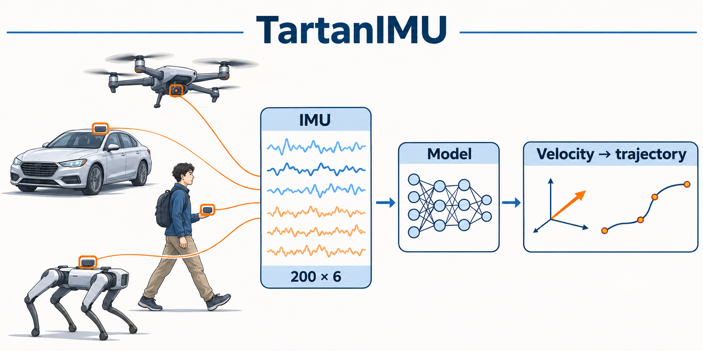
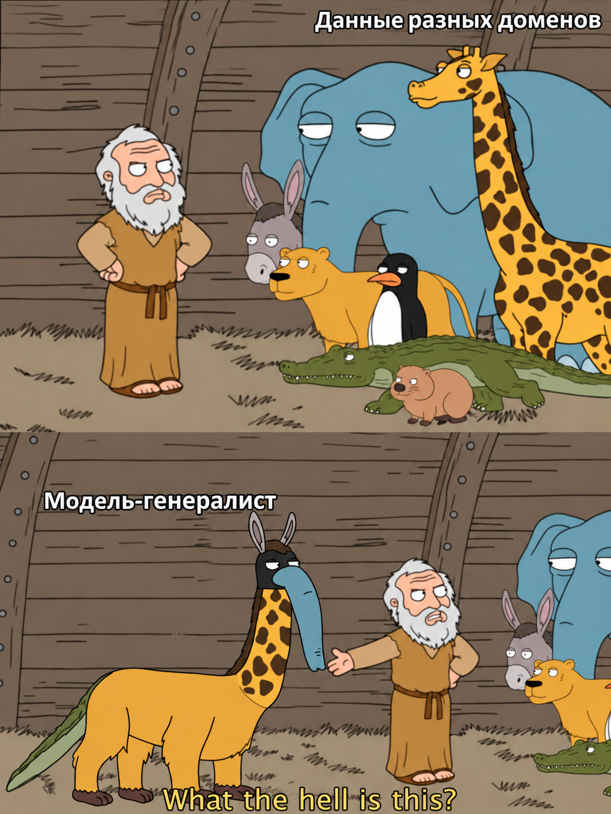
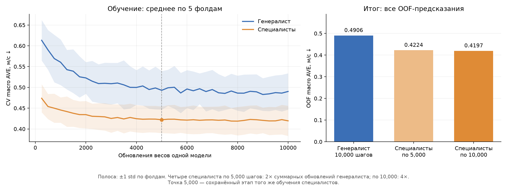

# TartanIMU: генералист и специалисты



### Быстрый запуск

1. **Установи [uv](https://docs.astral.sh/uv/getting-started/installation/)**, если его ещё нет (macOS/Linux):

   ```bash
   curl -LsSf https://astral.sh/uv/install.sh | sh
   ```

   После установки открой новый терминал. Все следующие команды выполняй **из корня репозитория**, где лежит `pyproject.toml`.

2. **Настрой окружение:**

   ```bash
   uv sync --locked
   ```

   uv подготовит Python 3.12.12 и установит зависимости в `.venv`. Вручную активировать окружение не нужно.

3. **Скачай [данные соревнования](https://www.kaggle.com/competitions/tartan-imu-challenge-iros2026/data)** и распакуй в
   `data/tartan-imu-challenge-iros2026/`. Внутри должны быть `index/`, `train/`, `val/`, `test/` и `sample_submission.csv`.

4. **Запусти обучение генералиста:**

   ```bash
   uv run --frozen python -m exps.baseline.train_steps \
     --config exps/baseline/configs/mlp_steps.py --output runs/my_first_run
   ```

   Команда обучит **5 фолдов по 10 000 шагов на CPU**. Веса и логи появятся в `runs/my_first_run/`,
   сводные метрики — в `reports/my_first_run/step_10000/summary.json`. Для повторного запуска укажи новое имя после `--output`.

Для EDA открой [ноутбук](notebooks/01_eda.ipynb), выбери интерпретатор `.venv/bin/python` и нажми **«Выполнить все»**.

## 1. Постановка задачи

[TartanIMU Challenge IROS2026](https://superodometry.com/imuchallenge/) — оценка движения по IMU автомобиля,
робособаки, дрона и датчика у человека. Модель предсказывает скорость за каждую секунду;
для оценки пути скорости затем интегрируются. Применение — инерциальная навигация разных платформ.

**Генералист — одна модель, обученная на всех четырёх платформах.**

**Специалисты — четыре отдельные модели: каждая обучается на одной платформе.**
При локальном сравнении специалист выбирается по известной платформе. На test эта метка скрыта.

**Почему генералист.** [Организаторы требуют единую модель](https://superodometry.com/imuchallenge/)
для всех четырёх платформ без переключения между платформенными специалистами.
Поэтому специалисты служат локальным ориентиром качества. Цель исследования — найти способ совместного обучения,
при котором один генералист достигнет их качества или превзойдёт его.

> **Гипотеза:** совместное обучение на данных разных источников помогает использовать закономерности разных
> платформ и **снижает macro AVE** относительно обычного совместного обучения и отдельных моделей под каждый источник.



Первый кандидат метода — **gate**: слой, который по IMU определяет вклад внутренних ветвей одной сети.
Сначала проверяем качество архитектур, затем в каждой сравниваем специалистов, обычного генералиста
и генералиста с gate. Аугментации — отдельный эксперимент.

**Исследовательские вопросы**

1. Снизится ли AVE и генералиста, и специалистов при замене MLP на **Conv1d + GRU**
   при том же секундном входе, фолдах и числе обновлений? GRU — выбранный вариант RNN.
2. Снизит ли **gate по IMU** AVE генералиста относительно общей модели без gate и отдельных специалистов?
   Повторяем сравнение на обеих архитектурах и учитываем число параметров.
3. Снизят ли **аугментации IMU** — шум, смещения и согласованные вращения — CV AVE?
   Сохранится ли улучшение в официальном test score после фиксации настроек по CV?

## 2. Формализация задачи

| Что | Определение |
|---|---|
| Тип задачи | Регрессия трёх компонентов скорости |
| Наблюдение | Неперекрывающееся окно 1 с из одной траектории |
| Вход `X` | `(200, 6)`: ускорение XYZ, м/с²; гироскоп XYZ, рад/с; частота ≈200 Гц |
| Таргет `y` | `(vx, vy, vz)`, м/с: среднее покадровых `vel_body` за окно |
| Система координат | Оси датчика, body frame; гравитация в ускорении сохранена |
| На inference | Только IMU; без позиции, quaternion, метки платформы и ID |

По короткому IMU-окну скорость не всегда определяется однозначно: модель использует закономерности движений в train.

## 3. Данные (EDA)

Источник — [архив соревнования](https://superodometry.com/imuchallenge/data/).
Словарь колонок, проверки и графики — в [EDA-ноутбуке](notebooks/01_eda.ipynb).

| Split | Траекторий | Окон по 1 с |
|---|---:|---:|
| train | 395 | 81 931 |
| val | 80 | 23 714 |
| test | 89 | 30 644 |

| Платформа | Train-траекторий | Train-окон | Медиана нормы таргета, м/с | 99-й процентиль, м/с |
|---|---:|---:|---:|---:|
| car | 44 | 23 533 | 0.427 | 2.225 |
| dog | 36 | 14 915 | 0.209 | 1.377 |
| drone | 289 | 14 213 | 0.908 | 8.060 |
| human | 26 | 29 270 | 0.112 | 1.338 |

**Что учитываем при обучении:**

- Разбиваем **целые траектории** со стратификацией по платформе. Специалисты используют те же фолды, что и генералист.
- Нормализация — только по train-части фолда; вход — только IMU.
- Домены несбалансированы: drone даёт больше траекторий, human — больше окон. Смотрим метрику каждого домена.
- Сравнили медианы средних ускорений по траекториям: у human основной сигнал по **−Y**, у остальных — по **+Z**.
  Это согласуется с разной ориентацией датчика, но не доказывает фиксированную установку. Нормализация оси не выравнивает.
- Во всех 564 NPZ нет NaN/Inf; CSV-цели совпадают со средним `vel_body`. Неполные хвосты исключены индексом.
  Пики IMU отмечаем, но автоматически не удаляем; гравитацию сохраняем.

Скорости получены из GT-позиции и ориентации: возможные ошибки исходной разметки и синхронизации
переходят в таргет. Усреднение за секунду скрывает изменения движения внутри окна.

## 4. Baseline

MLP с нуля — простая точка отсчёта для проверки данных, обучения и сравнения доменов.

```text
IMU (200,6) → нормализация → Flatten → Linear(1200,128) → ReLU
           → Linear(128,64) → ReLU → Linear(64,3)
```

| Настройка | Значение |
|---|---|
| Параметры одной модели | 162 179 |
| Бюджет | **10 000 обновлений весов** каждой модели; полный batch 256 |
| Обучение | MSE; Adam; learning rate 0.001; weight decay 0.0001 |
| Валидация | Каждые 250 шагов; результат — веса на заданном конечном шаге |
| Нормализация | Среднее и std шести каналов по train-части фолда |
| Воспроизводимость | Seed фолдов 42; seed модели 42 + fold; CPU, 4 потока |

Специалистов оцениваем на **5000 и 10 000 шагах**, используя снимки одного обучения.
Четыре специалиста получают суммарно 20 000 или 40 000 обновлений на фолд;
генералист — 10 000. Это сравнения с разным суммарным бюджетом. Gate, RNN и аугментации пока не реализованы.

<details>
<summary><b>Специалисты, сравнение и структура проекта</b></summary>

После быстрого запуска выше можно обучить специалистов и сравнить их с генералистом:

```bash
uv run --frozen python -m unittest discover -s tests

for platform in car dog drone human; do
  uv run --frozen python -m exps.baseline.train_steps \
    --config "exps/baseline/configs/mlp_steps_${platform}.py" \
    --output "runs/mlp_10k_${platform}_repro"
done

uv run --frozen python -m scripts.compare_steps \
  --generalist runs/my_first_run \
  --specialists runs/mlp_10k_car_repro runs/mlp_10k_dog_repro runs/mlp_10k_drone_repro runs/mlp_10k_human_repro \
  --output reports/comparison_10k_repro

uv run --frozen python -m scripts.prediction_checks \
  --run runs/my_first_run --output reports/baseline_checks_repro

# Оценить один checkpoint на официальном val
uv run --frozen python -m scripts.evaluate \
  --checkpoint runs/my_first_run/fold_0/final.pt \
  --split val --output reports/val_check

uv run --frozen python -m scripts.predict \
  --checkpoint runs/my_first_run/fold_0/final.pt \
  --output runs/my_first_run/submission.csv
```

Повторный запуск требует нового имени каталога. В `runs/` — веса, OOF-прогнозы, настройки, версии и счётчики;
в `reports/` — компактные отчёты. `data/`, `runs/` и `reports/` исключены из Git. CSV submission не загружается автоматически.
Пример использует одну fold-модель; итоговый генералист ещё не переобучен на всём train.

```text
src/                 # data/, model/, evaluation/, metrics.py, inference.py
exps/baseline/       # train_steps.py и отдельные Python-конфиги
scripts/             # точки входа оценки, сравнения и submission
notebooks/           # EDA-ноутбук и его вспомогательные функции
reports/             # метрики, таблицы, графики и compute
```

</details>

## 5. Протокол оценки

**Локально:** пять фолдов внутри официального train. Стратифицируем траектории по платформе,
сохраняя примерные доли доменов. `folds.csv` общий для генералиста и специалистов.
Официальный val — отдельная проверка после выбора настроек.

**AVE, м/с; меньше — лучше:** для окна считаем `‖v_pred − v_gt‖₂`, затем усредняем
**окна → траектории → платформы**. Каждая платформа имеет вес 25%.
AVE напрямую измеряет ошибку целевой скорости и соответствует скоростной части метрики соревнования.
Показываем общую OOF AVE и среднее ± std пяти фолдов; std — не доверительный интервал.

**Соревнование:** test GT скрыта, оценка предсказаний выполняется через submission.
Score сочетает AVE и ATE20 — ошибку интегрированного пути на участках около 20 м:

```text
Score = 0.6 × AVE / 0.7356384388 + 0.4 × ATE20 / 3.1160277267
```

GT-ориентация используется организаторами только при оценке. Локальный ATE20 ещё не проверен;
результаты ниже относятся к AVE. Test score пока не измерен.

**Выбор модели и честность сравнения:**

- Конфигурацию выбираем по средней macro AVE пяти фолдов. Public leaderboard — внешняя проверка
  после фиксации настроек, а не источник подбора гиперпараметров.
- В каждой архитектуре фиксируем вход, preprocessing, фолды, seeds и бюджет; показываем одинаковые
  шаги одной модели и отдельно сообщаем суммарные затраты четырёх специалистов.
- Для gate нужен контроль без gate сопоставимого размера. Параметры и время сообщаем отдельно:
  одинаковые шаги разных архитектур не гарантируют одинаковые FLOPs.
- Окна одной траектории не делим между train и validation. Session/subject ID нет:
  полностью исключить общие исходные сессии, людей или маршруты нельзя.

**Диагностика:** train/OOF MSE, AVE нулевого и среднего train-прогноза, ошибки по доменам и скорости,
разброс компонентов предсказания. Это помогает заметить константный прогноз; один низкий loss этого не гарантирует.

## 6. Результаты baseline

MLP, генералист — 10 000 шагов, специалисты — по 5000 и 10 000; оценка на заданном шаге. **OOF:** каждое train-окно предсказано моделью,
не обучавшейся на его траектории. Все строки оценены на одинаковых окнах.

| Метод | OOF macro AVE ↓, м/с | CV mean ± std, м/с |
|---|---:|---:|
| Нулевой прогноз | 0.68286 | — |
| Средний вектор train-части фолда | 0.69888 | — |
| **Генералист, 10 000 шагов** | 0.49057 | 0.49018 ± 0.04374 |
| Специалисты, по 5000 шагов | 0.42237 | 0.42216 ± 0.03215 |
| Специалисты, по 10 000 шагов | **0.41972** | **0.41952 ± 0.03631** |

AVE специалистов ниже на **13.9%** при 5000 шагах и на **14.4%** при 10 000.
Суммарно четыре специалиста получают соответственно **вдвое и вчетверо больше обновлений**, чем генералист.
Улучшенный генералист пока не обучен. У специалистов больше суммарных параметров и известна платформа:
это исходное локальное сравнение, а не доказательство причины разрыва или результат на test.

Срезы ошибок генералиста: почти неподвижным окнам добавляется движение
(средняя норма GT **0.030**, прогноза **0.125 м/с**); быстрые окна `>2 м/с` в среднем недооцениваются
(**3.734 → 2.844 м/с**); наибольшая OOF AVE — у drone (**0.888 м/с**).
Срезы по скорости усреднены по окнам и не заменяют macro AVE.



Слева — средняя CV AVE пяти фолдов; для специалистов внутри каждого фолда сначала усредняются четыре домена.
Справа — итоговая OOF AVE. Результат специалистов на 5000 шагах близок к результату на 10 000 в этом прогоне.

<details>
<summary><b>По платформам и затратам</b></summary>

| Домен | Генералист, 10 000 | Специалист, 5000 | Специалист, 10 000 |
|---|---:|---:|---:|
| car | 0.49425 | 0.43719 | 0.42614 |
| dog | 0.34538 | 0.21534 | 0.21276 |
| drone | 0.88810 | 0.85067 | 0.85580 |
| human | 0.23457 | 0.18627 | 0.18420 |

Затраты суммированы по пяти фолдам. Время обучения включает получение батчей, но исключает валидацию и предварительную загрузку данных;
CPU seconds — сумма времени потоков, wall seconds — прошедшее реальное время.

| Затраты | Генералист, 10 000 | Специалисты, по 5000 | Специалисты, по 10 000 |
|---|---:|---:|---:|
| Обновления весов | 50 000 | 100 000 | 200 000 |
| Обработанные окна с повторами | 12 800 000 | 25 600 000 | 51 200 000 |
| Обучение, wall seconds | 65.84 | 126.85 | 253.31 |
| Обучение, CPU seconds | 95.22 | 185.88 | 371.27 |

Короткие снимки специалистов взяты из того же обучения; затраты сценариев не складываем.
Времена относятся к CPU macOS/arm64, четырём потокам и зависят от нагрузки.

Предыдущие прогоны генералиста: три эпохи — **0.55888**, 8000 шагов — **0.48653**.
Увеличение бюджета до 10 000 не улучшило результат относительно 8000 в этом наборе seeds.

Локальные отчёты создаются после запуска: сравнение, график и compute — в `reports/comparison_10k/`,
диагностика предсказаний — в `reports/baseline_checks_10k/`. Они не хранятся в Git;
итоговые результаты приведены в таблицах выше.

</details>

<details>
<summary>Источники и помощь агентов</summary>

- [Данные](https://superodometry.com/imuchallenge/data/) и [протокол организаторов](https://superodometry.com/imuchallenge/setup/).
- [Scorer организаторов](https://github.com/superxslam/TartanIMU/blob/8a8025000f85d2c6b0692b88e15c2c91e761f7d7/starter/kaggle_metric_tartanimu_score.py) — источник определения AVE; здесь отдельная реализация, полная метрика не скопирована.
- Код, EDA и README подготовлены с помощью **Codex / OpenAI и агентов**.
  Модель по указанию автора: **GPT-6.1 Sol, high**.
- Иллюстрация создана встроенным `image_gen`; [промпт](assets/tartan_imu_overview.prompt.md).
- Исходник мема предоставлен автором проекта; подписи добавлены `image_gen` ([промпт](assets/generalist_domains_meme.prompt.md)).

</details>

## 7. Выводы

1. Получилось обучить бейзлайн и показать, что при обучении стандартным подходом через MLP генералист не показывает качества лучше, чем набор отдельных специалистов.
2. Бейзлайн не даёт полной картины для проверки гипотезы - треубется проверить более сильные архитектуры.
3. Гипотеза остается той же, но требуется добавить ограничение на архитектуры решения, т.к. с учетом обучения генералиста можно вводить дополниетльные архитектурные измнения, которые позволят растить качество в единой модели.
4. Текущее решение проверяет лишь один из многочисленных методов обучения модели.
