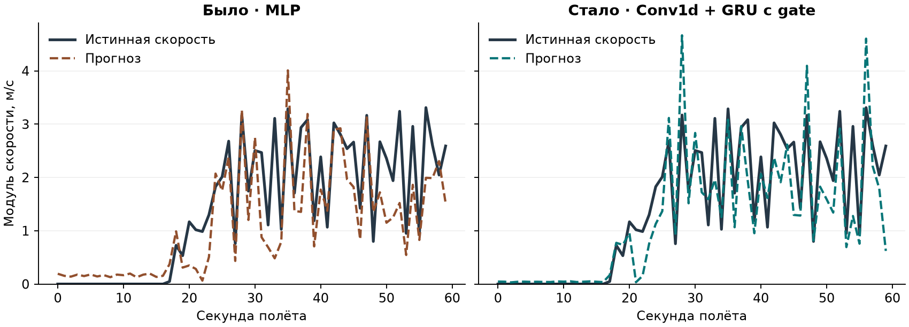

# ДЗ 2 · TartanIMU

**ДЗ 2 выполнено агентами.** Здесь два исследовательских вопроса. Можем ли мы точнее предсказывать скорость по одной секунде инерциальных измерений? Поможет ли это одной модели, обученной на четырёх платформах, приблизиться к четырём специализированным моделям?

На первый вопрос ответ положительный. Ошибка генералиста снизилась на **13,1%**. На второй ответ зависит от точки сравнения. В полном переходе от MLP к новой архитектуре специалисты улучшились ещё сильнее. Если оставить архитектуру той же и включить только gate, ошибка генералиста снизилась на **0,00934 м/с**, а специалистов — на **0,00819 м/с**. Разница между выигрышами составила **0,00115 м/с**.

## От показаний датчика к прогнозу

За секунду поступает 200 отсчётов. В каждом шесть чисел — ускорение и угловая скорость по трём осям. Цель модели — средний за секунду вектор скорости в системе координат платформы. Чтобы понять, зачем здесь три числа, представим движение вперёд со скоростью 1 м/с. Прогноз движения назад с той же скоростью даст правильный модуль, но ошибку вектора 2 м/с. Именно такую ошибку направления учитывает AVE.


| Шаг | Было · MLP | Стало · Conv1d + GRU с gate |
|---|---|---|
| Вход | 200 × 6 нормализованных показаний | Те же 200 × 6 показаний |
| Обработка времени | Секунду разворачиваем в список из 1 200 чисел. MLP учит веса для их позиций | Делим секунду на четыре последовательных участка по 50 отсчётов. Одна свёртка обрабатывает каждый участок, GRU последовательно обновляет состояние |
| Выход | Одна голова выдаёт три компоненты скорости | Четыре внутренние ветви выдают по три компоненты. Gate вычисляет веса из состояния GRU, итогом становится взвешенное среднее четырёх прогнозов |
| Параметры одного генералиста | 162 179 | 33 072 |

**Почему ветвь и специалист — разные единицы сравнения.** Каждый специалист проходит отдельное обучение на данных одной платформы. Ветви получают общий сигнал внутри одной модели и обучаются вместе. Веса смешивания в сумме дают единицу. Например, при весах 0,7 / 0,1 / 0,1 / 0,1 первая ветвь даёт 70% итоговой взвешенной суммы. Это условный пример работы слоя. Метки «дрон» или «машина» на вход gate не подаются. [Реализация модели](../../src/model/window.py) · [Промпт иллюстрации](../../assets/hw2_before_after.prompt.md)

## Эксперимент

- **Временной энкодер.** Исходный MLP занижал высокие скорости и давал наибольшую ошибку на дроне. Временная модель обрабатывает четыре последовательных участка по 50 отсчётов. Для каждого участка используется одна свёртка с 32 выходами, ядром и шагом 50, далее ReLU и GRU с состоянием размерности 64. Свёртка реализована как общее линейное преобразование неперекрывающихся участков. Тест сверяет его с `torch.conv1d`. Выход обоих энкодеров содержит 64 признака.
- **Адаптивное смешивание.** Разные платформы и режимы движения могут требовать разных преобразований признаков. После энкодера располагаются четыре ветви по 16 скрытых нейронов с ReLU и трёхмерным выходом. `fixed` обучает четыре общих логита. В `gate` к тем же логитам прибавляется линейная функция признаков данного окна. Softmax задаёт веса усреднения четырёх выходов. Обе версии начинают с одинаковых весов ветвей и равномерного смешивания. У gate на 256 параметров больше. Метки платформ не входят в модель.
- **Абляции.** От полной `temporal_gate` переходим к `temporal_fixed`, сохраняя энкодер и ветви, и к `mlp_gate`, сохраняя способ смешивания и размерность выхода энкодера. Дополнительные пары проверяют gate у MLP и смену энкодера с одной выходной головой. Серия сравнивает шесть конфигураций в двух режимах обучения.
- **Критерий.** Для каждого фолда считаем выигрыш как AVE контроля минус AVE изменённой модели. Дополнительная польза для генералиста равна его выигрышу минус выигрыш специалистов. До получения результатов выбрали 0,01 м/с как границу практически небольшого изменения средней CV macro AVE специалистов. Порог описывает наблюдаемый эффект. Пять фолдов с пересекающимися обучающими частями и одна схема seeds ограничивают вывод о статистической эквивалентности.

## Протокол

Те же 395 train-траекторий и 81 931 секундное окно, что в ДЗ 1. [Зафиксированное разбиение](folds.csv) проверяется при запуске. Одна траектория целиком находится в одном валидационном фолде. Среднее и std каналов IMU считаются по обучающим окнам конкретной модели и фолда. Список идентификаторов train и validation сохраняется в checkpoint. Информации об исходных сессиях и субъектах для более строгого разбиения нет.

Каждой модели даются 10 000 обновлений Adam с batch 256, MSE, learning rate 0,001, weight decay 0,0001. Seed разбиения 42, seed обучения 42 + номер фолда. Прогоны на CPU с четырьмя потоками PyTorch. Все сравнения используют последний шаг. Четыре специалиста получают суммарно 40 000 обновлений на фолд. Время в таблице суммируется по моделям и фолдам, при параллельных запусках на него влияет нагрузка машины.

Для каждого окна вычисляется норма ошибки вектора скорости. Средние считаются последовательно по траекториям и платформам с равным весом платформ. Критерий выбора генералиста — средняя macro AVE пяти фолдов. Вторая оценка, OOF macro AVE, использует все отложенные предсказания вместе. Стандартное отклонение по фолдам описывает разброс. Официальный val используется для оценки после выбора. Test имеет скрытую разметку.

## Результаты

Лучшая единая модель — **Conv1d + GRU с gate по IMU**. Средняя CV macro AVE снизилась с 0,49018 до **0,42575 м/с** относительно MLP из ДЗ 1, на **13,1%**. У специалистов той же архитектуры результат **0,33808 м/с**. В абсолютных числах разрыв с сопоставимыми специалистами вырос с 0,07066 у обычного MLP до 0,08768 м/с у полной модели.

В таблице приведены средние пяти фолдов. В CSV дополнительно указаны стандартные отклонения, общая OOF AVE, параметры, число обновлений и измеренное время. [Таблица экспериментов](results/experiments.csv) · [Запуски в ClearML](results/clearml.csv)

| Энкодер | Выход модели | Генералист, м/с ↓ | Специалисты, м/с ↓ | Параметров на модель |
|---|---|---:|---:|---:|
| MLP | Одна голова | 0,49018 | 0,41952 | 162 179 |
| MLP | Ветви с общими весами | 0,47524 | 0,39709 | 166 352 |
| MLP | Ветви с gate по IMU | 0,47304 | 0,38085 | 166 608 |
| Conv1d + GRU | Одна голова | 0,47246 | 0,36281 | 28 643 |
| Conv1d + GRU | Ветви с общими весами | 0,43510 | 0,34627 | 32 816 |
| Conv1d + GRU | Ветви с gate по IMU | 0,42575 | 0,33808 | 33 072 |

Для чтения таблицы полезно сначала проследить один путь. У **генералиста** замена только энкодера снизила ошибку с 0,49018 до 0,47246 м/с. Добавление четырёх ветвей с общими весами снизило её до 0,43510. Веса, зависящие от конкретного окна, дали последние 0,00934 м/с улучшения. Так видно, почему весь выигрыш в 13,1% нельзя приписать одному gate. Если включать компоненты в другом порядке, их отдельные вклады могут измениться.

### Что показали абляции

1. **Замена временного энкодера на MLP при включённом gate** повышает ошибку генералиста на **0,04729 м/с**, специалистов на **0,04278 м/с**. Временной энкодер выигрывает на всех пяти фолдах у обеих сторон. У обычных моделей с одной головой переход на Conv1d + GRU сильнее помогает специалистам: выигрыш 0,05671 против 0,01772 м/с у генералиста.
2. **Замена адаптивного gate общими весами ветвей при Conv1d + GRU** повышает ошибку генералиста на **0,00934 м/с**, специалистов на **0,00819 м/с**. Обе стороны выигрывают от gate на пяти фолдах. Дополнительный выигрыш генералиста — всего **0,00115 м/с**. Среднее изменение специалистов укладывается в заранее заданный порог 0,01 м/с. По платформам эффект различается: у специалиста drone OOF AVE снизилась с 0,7343 до 0,7122 м/с, у human выросла с 0,1715 до 0,1730 м/с.
3. **Gate у MLP** дал генералисту 0,00219 м/с и выиграл на трёх фолдах из пяти. Это небольшой и неоднородный эффект. Специалисты выиграли 0,01624 м/с, что превышает выбранный порог. В этой архитектуре гипотеза о преимущественной пользе gate для генералиста не подтвердилась.

Наибольшее сокращение разрыва в этих парных сравнениях дали **сами ветви при временном энкодере**. Переход от одной головы к четырём ветвям с общими весами дал генералисту 0,03736 м/с, специалистам 0,01654 м/с. Дополнительный выигрыш генералиста 0,02082 м/с наблюдается в среднем и положителен на всех фолдах. Это эффект изменения выходной части вместе с её ёмкостью. Абляция gate поверх этих ветвей измеряет отдельно эффект зависимости весов от входа. [Парные разницы](results/paired.csv) · [Ошибки по платформам](results/domains.csv)


### Один полёт до и после

Для иллюстрации взяли полёт со средней позицией в списке, отсортированном по ошибке базового MLP. Из 289 траекторий дрона это 145-я, `drone_train_0224` из фолда 4. Все 60 секунд были отложены целиком для обеих моделей. Сплошная кривая показывает истинный модуль скорости. Пунктир показывает прогноз генералиста. Шкалы обеих панелей совпадают.



На отметке 31 с видна причина оценивать **вектор**. Истинная скорость по модулю равна 2,47 м/с. MLP оценил её в 0,88, финальная модель — в 1,72. По модулю вторая оценка ближе. При учёте направления ошибка, напротив, выросла с 1,72 до 3,38 м/с. На всём полёте новая модель выигрывает в 40 из 60 окон, а средняя векторная ошибка снижается с 0,755 до 0,733 м/с. [Данные обеих панелей](results/flight_example.csv)

Этот полёт иллюстрирует величину и направление ошибки. Чтобы оценить распространённость выигрыша, для каждой из 395 отложенных траекторий сравнили средние ошибки двух генералистов. Финальная архитектура выиграла на 43 из 44 автомобильных траекторий, 35 из 36 траекторий робособаки, 237 из 289 полётов и 17 из 26 траекторий человека. Счёт **332 из 395** показывает частоту улучшений. Основная метрика также учитывает их размер и даёт каждой платформе равный вес. [Подсчёт по платформам](results/trajectory_counts.csv)

### Ошибки и внешняя проверка

На 3 182 быстрых OOF-окнах (>2 м/с) ошибка финальной архитектуры генералиста снизилась с 1,774 до 1,494 м/с относительно MLP. Средняя предсказанная скорость выросла с 2,844 до 3,006 м/с при истинной 3,734 м/с. На 24 506 почти неподвижных окнах (<0,1 м/с) ошибка снизилась с 0,125 до 0,086 м/с. Срезы усреднены по окнам. Результат согласуется с гипотезой о пользе временной структуры для движения, хотя механизм улучшения по одним предсказаниям установить нельзя. [Срезы по скорости](results/speed.csv)


Конфигурация выбрана по CV. Её обучили с seed 42 на всех 395 train-траекториях, затем проверили на 80 траекториях официального val. **Val macro AVE — 0,45190 м/с**. По платформам: car 0,38243, dog 0,28174, drone 0,96065, human 0,18276 м/с. Наибольшая ошибка остаётся у дрона. Для Kaggle сформирован файл на 30 644 окна с порядком строк и колонок официального шаблона. Официальный test score станет известен после ручной отправки. [Проверка val и файла](results/official_val.json)

## Воспроизведение

Из корня репозитория после загрузки данных по [инструкции ДЗ 1](../../README.md):

```bash
uv sync --locked
uv run --frozen clearml-init  # один раз на машине, если доступ ещё не настроен
uv run --frozen python -m unittest discover -s tests
uv run --frozen python -m exps.hw2.run --workers 3
uv run --frozen python -m exps.hw2.results
uv run --frozen python -m exps.hw2.analysis
uv run --frozen python -m exps.hw2.flight_example
uv run --frozen python -m exps.hw2.final
uv run --frozen python -m exps.hw2.publish_summary
```

Если сохранены прогоны ДЗ 1 из `runs/mlp_10k_*`, `mlp_plain` импортирует их с тегом `HW1-import`. На чистой копии он обучается в той же матрице. Один запуск можно выполнить командой `uv run --frozen python -m exps.hw2.train temporal_gate dog` и синхронизировать командой `uv run --frozen python -m exps.hw2.track temporal_gate dog`. Завершённые фолды сохраняются локально. Если синхронизация прервалась, команда трекинга повторно использует сохранённый ID задачи.

В ClearML одна задача соответствует сочетанию архитектуры, способа смешивания и обучающей платформы на пяти фолдах. В ней хранятся гипотеза, конфиг, метрики по шагам, фолды и OOF-прогнозы. Записи загружаются после завершения пяти фолдов из сохранённых локальных логов. В отдельной итоговой задаче находятся сводная таблица, графики, веса выбранной модели и метрики официального val. Файл для ручной отправки создаётся в `runs/hw2/final/submission.csv`.
