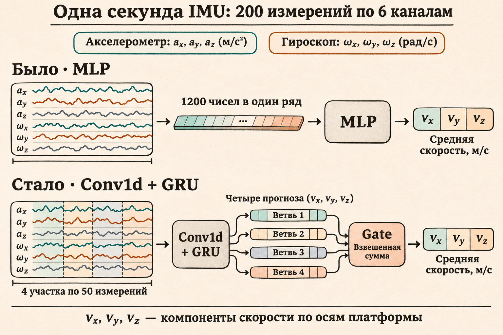
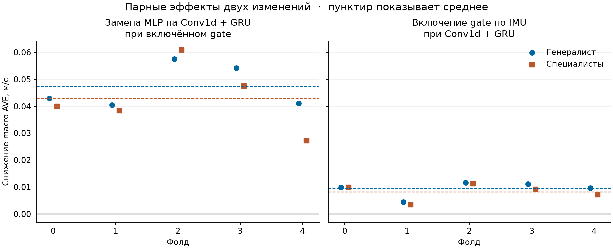
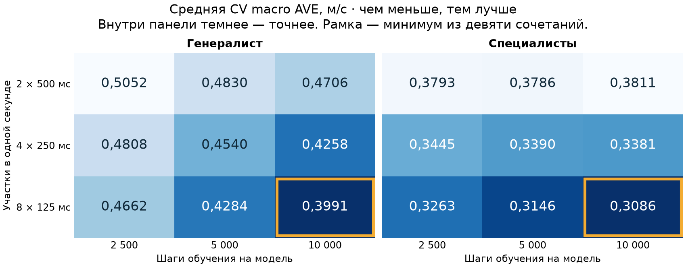
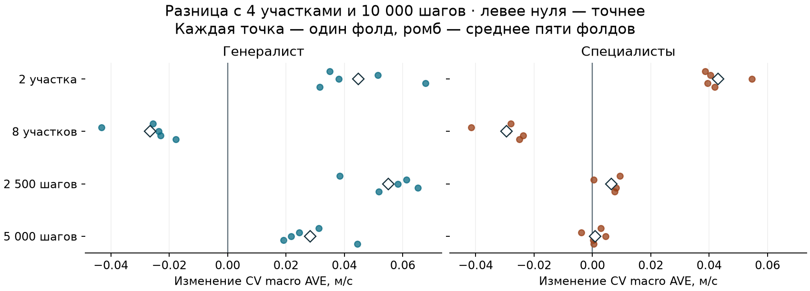
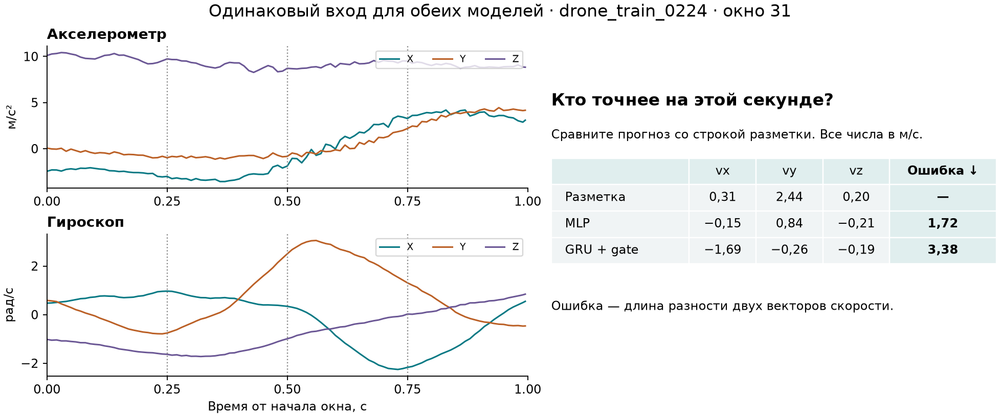
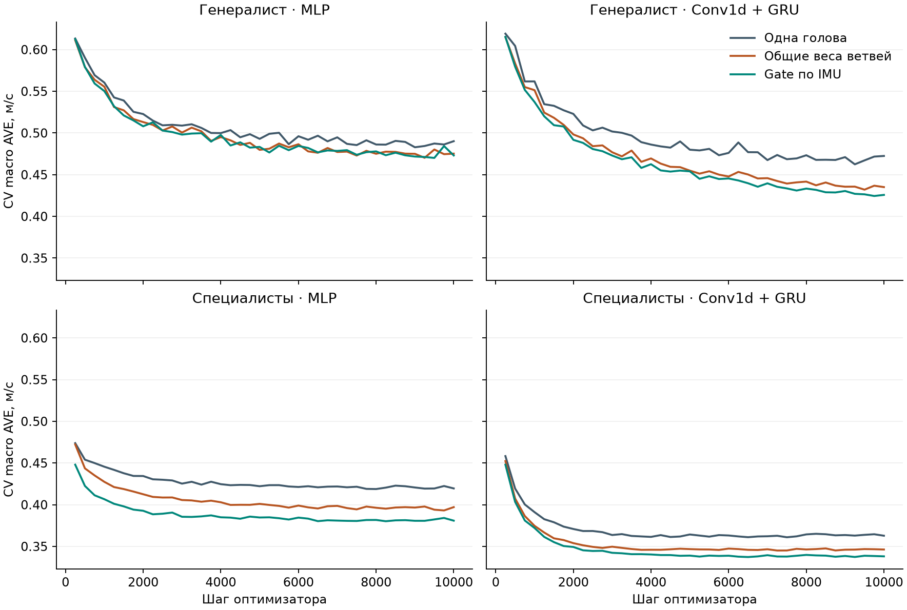

# ДЗ 2 · TartanIMU

**ДЗ 2 выполнено агентами.** Оцениваем скорость по одной секунде IMU у автомобиля, дрона, робособаки и человека. Генералист учится на всех платформах, специалист — на одной. Для каждой архитектуры сравниваем генералиста с четырьмя специалистами тех же размеров.

| Вопрос | Результат |
|---|---|
| Помогают ли две фичи генералисту? | Временной энкодер и gate вместе снизили CV macro AVE с 0,49018 до 0,42575 м/с (−13,1%) |
| Почему взяли четыре участка? | Четыре участка по 250 мс были исходной настройкой. В отдельной проверке восемь участков по 125 мс оказались точнее у генералиста на всех пяти фолдах |
| Закрылся ли разрыв со специалистами? | Он вырос с 0,071 до 0,088 м/с. Если менять только gate у временной модели, разрыв сокращается на 0,00115 м/с |

[Постановка задачи и данные ДЗ 1](../../README.md#1-постановка-задачи)

## От показаний датчика к прогнозу

За секунду поступает 200 отсчётов. В каждом шесть чисел — ускорение и угловая скорость по трём осям. Цель модели — средний за секунду вектор скорости в системе координат платформы. Чтобы понять, зачем здесь три числа, представим движение вперёд со скоростью 1 м/с. Прогноз движения назад с той же скоростью даст правильный модуль, но ошибку вектора 2 м/с. Именно такую ошибку направления учитывает AVE.



| Шаг | Было · MLP | Стало · Conv1d + GRU с gate |
|---|---|---|
| Вход | 200 × 6 нормализованных показаний | Те же 200 × 6 показаний |
| Обработка времени | Секунду разворачиваем в список из 1 200 чисел. MLP учит веса для их позиций | Делим секунду на четыре последовательных участка по 50 отсчётов. Одна свёртка обрабатывает каждый участок, GRU последовательно обновляет состояние |
| Выход | Одна голова выдаёт три компоненты скорости | Четыре внутренние ветви выдают по три компоненты. Gate вычисляет веса из состояния GRU, итогом становится взвешенное среднее четырёх прогнозов |
| Параметры одного генералиста | 162 179 | 33 072 |

## Эксперимент

| Фича | Гипотеза по результатам ДЗ 1 | Как проверяем вклад |
|---|---|---|
| Временной энкодер Conv1d + GRU | MLP занижал скорость на быстрых окнах. Последовательность локальных движений может помочь оценить разгон | Возвращаем MLP, оставляем тот же gate |
| Адаптивное смешивание (gate) | Генералист отставал от специалистов. Веса, зависящие от движения, могут помочь одной сети на разных платформах | Оставляем энкодер и четыре ветви, заменяем gate общими обучаемыми весами |

Матрица из двух энкодеров и трёх выходных слоёв дополнительно показывает, помогают ли четыре ветви сами по себе.

<details>
<summary>Устройство энкодера и выходных ветвей</summary>

Временной энкодер применяет к каждому участку одну свёртку с 32 выходами, ядром и шагом 50, затем ReLU и GRU с состоянием размерности 64. Общее линейное преобразование неперекрывающихся участков в реализации сверено тестом с `torch.conv1d`.

У каждой из четырёх ветвей 16 скрытых нейронов с ReLU и три выхода. В варианте `fixed` модель обучает четыре числа, общие для всех окон. В варианте `gate` к ним прибавляется линейная функция признаков текущего окна. Softmax превращает полученные числа в веса с суммой 1. Обе версии начинают с одинаковых параметров ветвей и равномерного смешивания. У `gate` на 256 параметров больше.

</details>

**Как проверяем пользу для совместного обучения.** Для каждого фолда считаем выигрыш как AVE контроля минус AVE изменённой модели. Дополнительная польза для генералиста равна его выигрышу минус выигрыш специалистов. До получения результатов выбрали 0,01 м/с как границу практически небольшого изменения средней CV macro AVE специалистов. Порог описывает наблюдаемый эффект. Пять фолдов с пересекающимися обучающими частями и одна схема seeds ограничивают вывод о статистической эквивалентности.

## Протокол

| Условие | Как зафиксировано |
|---|---|
| Разбиение | 395 train-траекторий, 81 931 окно. Пять фолдов со стратификацией по платформе, seed 42. Целая траектория попадает в один фолд |
| Защита от утечки | Нормализация по обучающим окнам каждого фолда. Модель получает только IMU. Идентификаторы участников и сессий недоступны |
| Обучение | Adam, MSE, batch 256, learning rate 0,001, weight decay 0,0001, CPU. Seed обучения равен 42 + номер фолда |
| Бюджет | Для сравнения фич — 10 000 шагов **на модель**. Четыре специалиста суммарно получают 40 000 шагов на фолд |
| Основная метрика | Для секунды берём длину разности двух векторов скорости. Усредняем по секундам траектории, траекториям платформы, затем по четырём платформам. CV macro AVE — среднее пяти фолдов в м/с |
| Внешняя проверка | Перед проверкой официального val зафиксировали победителя сравнения шести архитектур. Последующий анализ гиперпараметров использует только train-фолды |

[Разбиение по траекториям](folds.csv) · [Метрики по фолдам](results/folds.csv)

## Результаты

### Архитектурные фичи

Средние пяти фолдов при одинаковом бюджете на модель. [Стандартные отклонения, параметры и время](results/experiments.csv) · [Запуски ClearML](results/clearml.csv)

| Энкодер | Выход модели | Генералист, м/с ↓ | Специалисты, м/с ↓ | Параметров на модель |
|---|---|---:|---:|---:|
| MLP | Одна голова | 0,49018 | 0,41952 | 162 179 |
| MLP | Ветви с общими весами | 0,47524 | 0,39709 | 166 352 |
| MLP | Ветви с gate по IMU | 0,47304 | 0,38085 | 166 608 |
| Conv1d + GRU | Одна голова | 0,47246 | 0,36281 | 28 643 |
| Conv1d + GRU | Ветви с общими весами | 0,43510 | 0,34627 | 32 816 |
| Conv1d + GRU | Ветви с gate по IMU | 0,42575 | 0,33808 | 33 072 |

### Отключение фич по одной

| Что выключили в полной модели | Рост AVE генералиста, м/с | Рост AVE специалистов, м/с | На скольких фолдах выросла ошибка |
|---|---:|---:|---|
| Временной энкодер → вернули MLP | +0,04729 | +0,04278 | 5 из 5 у обеих сторон |
| Gate по IMU → общие веса четырёх ветвей | +0,00934 | +0,00819 | 5 из 5 у обеих сторон |

Gate сократил разрыв со специалистами на **0,00115 м/с**. Изменение у специалистов уложилось в заранее выбранный порог 0,01 м/с. Одна серия seeds ограничивает вывод о таком малом эффекте.

| Дополнительная проверка | Выигрыш генералиста, м/с | Выигрыш специалистов, м/с | Наблюдение |
|---|---:|---:|---|
| Четыре ветви с общими весами вместо одной головы при Conv1d + GRU | 0,03736 | 0,01654 | Разрыв сократился на 0,02082 м/с. Вместе с числом ветвей выросло число параметров |
| Gate поверх тех же четырёх ветвей при MLP | 0,00219 | 0,01624 | Генералист выиграл на трёх фолдах из пяти. Гипотеза о преимущественной пользе для генералиста здесь не подтвердилась |



[Парные разницы](results/paired.csv) · [Ошибки по платформам](results/domains.csv)

### Абляции гиперпараметров

Проверили, сколько последовательных состояний нужно GRU за одну секунду, и успевают ли модели обучиться за половину или четверть исходного бюджета. Вход всегда содержит 200 отсчётов. Все четыре выходные ветви и gate включены.

В ячейках **генералист / специалисты**, средняя CV macro AVE в м/с. Меньше — лучше.

| Участков за секунду | Ядро и шаг Conv1d | Параметров | 2 500 шагов | 5 000 шагов | 10 000 шагов |
|---:|---:|---:|---:|---:|---:|
| 2 × 500 мс | 100 отсчётов | 42 672 | 0,5052 / 0,3793 | 0,4830 / 0,3786 | 0,4706 / 0,3811 |
| 4 × 250 мс | 50 отсчётов | 33 072 | 0,4808 / 0,3445 | 0,4540 / 0,3390 | 0,4258 / 0,3381 |
| 8 × 125 мс | 25 отсчётов | 28 272 | 0,4662 / 0,3263 | 0,4284 / 0,3146 | 0,3991 / 0,3086 |



**Лучший результат у обеих сторон — 8 участков по 125 мс и 10 000 шагов.** При переходе с четырёх участков на восемь ошибка снизилась у обеих сторон на всех пяти фолдах. У специалистов выигрыш даже чуть больше (0,02946 против 0,02662 м/с у генералиста).

При четырёх участках переход с 5 000 на 10 000 шагов снизил ошибку генералиста на **0,02825 м/с** (5 из 5 фолдов), специалистов — на **0,00088 м/с** (4 из 5).

#### Насколько результат повторяется по фолдам

| Изменили один параметр относительно 4 участков и 10 000 шагов | Изменение AVE генералиста, м/с | Фолдов с улучшением | Изменение AVE специалистов, м/с | Фолдов с улучшением |
|---|---:|---:|---:|---:|
| 2 участка по 500 мс | +0,04484 | 0 из 5 | +0,04301 | 0 из 5 |
| 8 участков по 125 мс | -0,02662 | 5 из 5 | -0,02946 | 5 из 5 |
| 2 500 шагов | +0,05500 | 0 из 5 | +0,00642 | 0 из 5 |
| 5 000 шагов | +0,02825 | 0 из 5 | +0,00088 | 1 из 5 |



Число участков меняет одновременно ядро свёртки, число её весов и длину последовательности для GRU. Сравнение измеряет суммарный эффект этих изменений. Бюджеты 2 500 и 5 000 шагов — оценки на промежуточных шагах тех же обучений. Для исходных четырёх участков использованы сохранённые логи. Для двух новых размеров обучили 50 моделей (2 размера × 5 фолдов × 5 обучающих выборок).

[Средние и разброс](results/sensitivity.csv) · [Все парные оценки](results/sensitivity_folds.csv) · [Сводный эксперимент ClearML](https://app.clear.ml/projects/705d76f5521741b5909f64851f0a8638/tasks/b6f99ea93daa4e3db377fd205746f41c/output/log) · [Реестр запусков](results/sensitivity_clearml.csv)

### Один полёт до и после

Из 289 траекторий дрона выбрали 145-ю по ошибке исходного MLP — `drone_train_0224` из фолда 4. Все 60 секунд были отложены для обеих моделей. На левой панели из ошибки MLP вычли ошибку GRU с gate для каждой секунды. Обе ошибки рассчитаны по трём компонентам скорости. Выше нуля выигрывает новая модель, ниже — MLP.


| Масштаб сравнения | Наблюдение |
|---|---|
| Самый большой выигрыш, секунда 37 | Векторная ошибка снизилась с 1,91 до 0,65 м/с |
| Самый большой проигрыш, секунда 31 | Ошибка выросла с 1,72 до 3,38 м/с. Новая модель ошиблась в направлении по оси Y |
| Весь полёт | Выигрыш в 40 окнах из 60. Средняя ошибка снизилась на 0,022 м/с (2,9%) |
| Все платформы | Выигрыш на 332 из 395 траекторий и на каждом из пяти фолдов. Средняя CV macro AVE снизилась на 13,1% |

[Ошибки по секундам](results/flight_example.csv) · [Результаты по фолдам](results/folds.csv) · [Количество улучшений](results/trajectory_counts.csv)

<details>
<summary>Разбор самого большого промаха GRU на этом полёте · секунда 31</summary>



Левые графики показывают общий вход моделей. Первая из 200 строк содержит ускорение **(−2,45; +0,06; +10,10) м/с²** и угловую скорость **(+0,47; +0,59; −1,02) рад/с**. Вертикальный пунктир отделяет четверти секунды. По этим кривым нельзя однозначно прочитать скорость дрона: для этого нужна в том числе его начальная скорость.

**Как проверить прогноз.** Справа в строке «Разметка» дана эталонная средняя скорость дрона за эту секунду. По оси Y у MLP абсолютное отклонение от неё равно примерно **|0,84 − 2,44| = 1,60 м/с**, а у GRU с gate — **|−0,26 − 2,44| = 2,70 м/с**. Последний столбец объединяет отклонения по всем трём осям: берём квадратный корень из суммы их квадратов, используя значения до округления. Получаем **1,72 м/с у MLP** и **3,38 м/с у GRU с gate**. На этом окне MLP ближе к разметке. Для вывода о моделях в целом ниже сравниваются все пять фолдов. [Сохранённые ошибки по секундам](results/flight_example.csv)

**Как ветви дали итоговый прогноз.** На этом окне получили следующие значения из checkpoint фолда 4. Каждая ветвь предлагает отдельный вектор скорости. Вес gate один для всех трёх компонент данной ветви.

| Внутри одной сети | Вес для этого окна | vx, м/с | vy, м/с | vz, м/с |
|---|---:|---:|---:|---:|
| Ветвь 1 | 83,4% | −1,83 | −0,30 | −0,20 |
| Ветвь 2 | 13,8% | −0,72 | −0,06 | +0,09 |
| Ветвь 3 | 1,0% | −0,66 | −0,56 | +0,16 |
| Ветвь 4 | 1,8% | −3,04 | +0,32 | −1,95 |
| **Взвешенная сумма** | **100%** | **−1,69** | **−0,26** | **−0,19** |

Например, чтобы получить `vy`, сеть умножает четыре числа в столбце `vy` на соответствующие веса и складывает. В таблице числа округлены после вычисления. Для следующего окна gate заново вычисляет веса. Все четыре ветви обучаются вместе на одном наборе данных. Специалист в этом исследовании — отдельная модель, обученная только на данных своей платформы. [Реализация смешивания](../../src/model/window.py) · [Промпт схемы](../../assets/hw2_before_after.prompt.md)

</details>

### Ошибки и внешняя проверка

| Скорость по разметке | Отложенных секунд | Ошибка MLP, м/с | Ошибка GRU с gate, м/с |
|---|---:|---:|---:|
| Меньше 0,1 м/с | 24 506 | 0,125 | 0,086 |
| Больше 2 м/с | 3 182 | 1,774 | 1,494 |

На быстрых окнах средний модуль прогноза вырос с 2,844 до 3,006 м/с при истинном 3,734 м/с. [Срезы по скорости](results/speed.csv)



| Официальный val, 80 траекторий | Автомобиль | Робособака | Дрон | Человек | Macro AVE |
|---|---:|---:|---:|---:|---:|
| Генералист, 4 участка, 10 000 шагов, м/с | 0,38243 | 0,28174 | 0,96065 | 0,18276 | **0,45190** |

После исходного сравнения шести архитектур выбранную конфигурацию обучили на всех 395 train-траекториях с seed 42. Файл для ручной отправки на Kaggle содержит 30 644 окна. [Проверка val и файла](results/official_val.json)

## Воспроизведение

Из корня репозитория после загрузки данных по [инструкции ДЗ 1](../../README.md):

```bash
uv sync --locked
uv run --frozen clearml-init  # один раз на машине, если доступ ещё не настроен
uv run --frozen python -m unittest discover -s tests
uv run --frozen python -m exps.hw2.run --workers 3
uv run --frozen python -m exps.hw2.results
uv run --frozen python -m exps.hw2.analysis
uv run --frozen python -m exps.hw2.flight_example
uv run --frozen python -m exps.hw2.final
uv run --frozen python -m exps.hw2.publish_summary
uv run --frozen python -m exps.hw2.run --patch-study --workers 3
uv run --frozen python -m exps.hw2.sensitivity --publish
```

Если сохранены прогоны ДЗ 1 из `runs/mlp_10k_*`, `mlp_plain` импортирует их с тегом `HW1-import`. На чистой копии он обучается в той же матрице. Один запуск можно выполнить командой `uv run --frozen python -m exps.hw2.train temporal_gate dog` и синхронизировать командой `uv run --frozen python -m exps.hw2.track temporal_gate dog`. Завершённые фолды сохраняются локально. Если синхронизация прервалась, команда трекинга повторно использует сохранённый ID задачи.

В ClearML одна задача соответствует сочетанию архитектуры, способа смешивания и обучающей платформы на пяти фолдах. В ней хранятся гипотеза, конфиг, метрики по шагам, фолды и OOF-прогнозы. Записи загружаются после завершения пяти фолдов из сохранённых локальных логов. В отдельной итоговой задаче находятся сводная таблица, графики, веса выбранной модели и метрики официального val. Файл для ручной отправки создаётся в `runs/hw2/final/submission.csv`.
