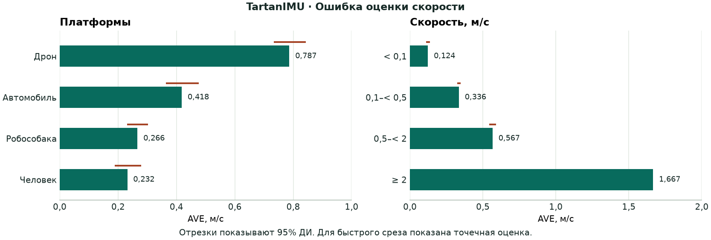

# HW 3 · Ошибки, абляции и воспроизводимость TartanIMU

[Интерактивный HTML](results/index.html) · [Таблицы абляций и seed](results/architecture-study/index.html) · [Артефакты](results/) · [Условие HW 3](https://github.com/PikaChuChuMF/RnD-ML-Course-2026-2/blob/main/HW_3/HomeWork_3.md)

Анализируем выбранный в HW 2 генералист `temporal_gate` с Conv1d + GRU и четырьмя ветвями с gate. Вход — 200 отсчётов IMU на шести осях за секунду, разбитых на четыре участка по 250 мс. Выход — средний вектор скорости в системе координат платформы. У генералиста 33 072 параметра, использованы чекпойнты на 10 000-м шаге. CV macro AVE на пяти фолдах составляет **0,42575 м/с** (95% ДИ **0,40166–0,45056**). Вариант с восемью участками позднее дал 0,3991 м/с в абляции. Для HW 3 взяли конфигурацию, зафиксированную в итоговом выборе HW 2. [Выбор модели](../hw2/results/selection.json) · [Эксперимент в ClearML](https://app.clear.ml/projects/705d76f5521741b5909f64851f0a8638/tasks/1f54b983b2994d4b95ed14c61d844331/output/log)



## 1. Типовые ошибки

Каждая строка показывает окно около 75-го перцентиля векторной ошибки среди окон соответствующего типа. Доли относятся к знаменателю в таблице. Типы могут пересекаться. В HTML доступны компоненты прогноза, соседние окна и исходные сигналы IMU. [Числа и идентификаторы окон](results/error-cases.csv) · [Разборы с графиками](results/index.html#cases)

| Тип | Окон в группе, доля и 95% ДИ | Реальный OOF-пример | Наблюдение и гипотеза |
|---|---|---|---|
| Ложное движение при эталоне < 0,1 м/с и прогнозе ≥ 0,3 м/с | 991 / 24 506 · 4,0% [3,3%; 4,8%] | `human_train_0020`, сек. 974, фолд 0 | Модуль прогноза 0,59 м/с при эталоне 0,05 м/с. Поворот или локальное движение датчика могли дать сигнал, похожий на поступательное движение. |
| Скорость занижена при эталоне ≥ 2 м/с, прогнозе < 70% эталона и угле < 30° | 807 / 3 182 · 25,4% [20,1%; 30,9%] | `drone_train_0243`, сек. 31, фолд 3 | 1,94 м/с при эталоне 4,24 м/с, векторы расходятся на 9°. Редкость быстрых окон и неоднозначность сигнала могут смещать MSE-прогноз к умеренным скоростям. |
| Ошибка направления при эталоне ≥ 0,5 м/с, прогнозе ≥ 0,25 м/с и угле ≥ 90° | 1 480 / 30 334 · 4,9% [3,9%; 6,0%] | `dog_train_0020`, сек. 1193, фолд 4 | Векторы расходятся на 168°, компонента X меняет знак. Вход за одну секунду может содержать мало информации о знаке скорости при равномерном движении. |
| Недооценка резкого изменения вектора. Эталон меняется ≥ 1 м/с, прогноз ≤ 50% от изменения эталона, ошибка ≥ 0,5 м/с | 967 / 7 529 · 12,8% [10,7%; 15,2%] | `drone_train_0170`, сек. 30, фолд 0 | Изменение эталона между соседними окнами 1,45 м/с, прогноза 0,49 м/с. Средняя скорость может зависеть от момента манёвра и состояния перед окном. |

Изменение между окнами измеряется в системе координат платформы. Поворот этой системы тоже может менять компоненты скорости. По одному модулю скорости теряются ошибки направления. Для навигации существенны знак и масштаб вектора, а в режиме остановки важны даже сравнительно небольшие ложные скорости.

## 2. Срезы по платформе и скорости

AVE для каждого среза считается как средняя длина ошибки вектора по окнам каждой траектории, затем по траекториям платформы, представленным платформам и фолдам. P90 и доли используют отдельные окна. Срез по платформе проверяет, насколько переносится качество единого генералиста. Порог 0,1 м/с выделяет окна около покоя, диапазон от 2 м/с позволяет отдельно проверить более редкие быстрые окна. [Все срезы, включая пересечение платформы и скорости](results/slices.csv)

| Платформа | Окон | Траекторий | AVE, м/с | 95% ДИ AVE | P90, м/с |
|---|---:|---:|---:|---:|---:|
| Дрон | 14 213 | 289 | 0,787 | [0,733; 0,843] | 1,474 |
| Автомобиль | 23 533 | 44 | 0,418 | [0,364; 0,476] | 0,841 |
| Робособака | 14 915 | 36 | 0,266 | [0,231; 0,303] | 0,646 |
| Человек | 29 270 | 26 | 0,232 | [0,189; 0,278] | 0,553 |

| Эталонная скорость, м/с | Окон | Траекторий | AVE, м/с | 95% ДИ AVE | Ошибка ≥ 1 м/с |
|---|---:|---:|---:|---:|---:|
| < 0,1 | 24 506 | 266 | 0,124 | [0,112; 0,138] | 0,2% |
| 0,1–< 0,5 | 27 091 | 345 | 0,336 | [0,324; 0,349] | 1,0% |
| 0,5–< 2 | 27 152 | 369 | 0,567 | [0,544; 0,590] | 11,8% |
| ≥ 2 | 3 182 | 137 | 1,667 | — | 61,5% [56,7%; 66,0%] |

Дрон имеет наибольшую AVE также внутри каждого диапазона скорости ниже 2 м/с. В быстром срезе 89% окон относятся к дрону. Для сравнения при фиксированной платформе взяли 121 траекторию дрона с окнами в обоих диапазонах. На них AVE растёт с **0,901** в диапазоне 0,5–< 2 м/с до **1,267** при ≥ 2 м/с, парная разность **+0,365 м/с** (95% ДИ **+0,289–+0,443**). Сравнение описывает связь со скоростью, в том числе возможное влияние режима движения на ней.

Для AVE быстрых окон в целом показана точечная оценка. В некоторых сочетаниях «фолд × платформа» есть только одна траектория. У быстрых робособаки и человека соответственно 5 окон из одной и 24 окна из трёх траекторий. Эти подгруппы дают ограниченные основания для вывода о новых траекториях.

## 3. Абляции и разброс по seed обучения

### Завершённая проверка seed

Для `temporal_gate_p25` с восемью участками сравнили базовые seed **42, 52 и 62** при 10 000 шагах на модель. У каждого полного CV-прогона одни и те же 395 отложенных траекторий и 81 931 OOF-окно. Seed обучения равен базовому seed плюс номер фолда. Модель с seed 42 взята из HW 2. Повторы для 52 и 62 обучались с одним потоком CPU и оценкой в конце обучения. В контрольном повторе фолда 0 с seed 42 максимальная разница одной компоненты прогноза составила 4,2 × 10⁻⁷ м/с. [Метрики всех платформ](results/seed-p25/summary.csv)

| Базовый seed | AVE генералиста, м/с | Score генералиста | AVE специалистов, м/с | Score специалистов |
|---:|---:|---:|---:|---:|
| 42 | 0,3991 | 0,5618 | 0,3086 | 0,4102 |
| 52 | 0,3926 | 0,5420 | 0,3082 | 0,4112 |
| 62 | 0,3933 | 0,5515 | 0,3075 | 0,4116 |
| Среднее ± выборочное SD | 0,3950 ± 0,0036 | 0,5517 ± 0,0099 | 0,3081 ± 0,0005 | 0,4110 ± 0,0007 |

На всех трёх seed специалисты опережают генералиста. По трём повторам Score генералиста меняется на 0,0199, у специалистов — на 0,0014. Эти числа характеризуют разброс при одной схеме фолдов.

Для воспроизведения нужны пять завершённых базовых запусков HW 2 (`all`, `car`, `dog`, `drone`, `human`). Закреплённый scorer скачивается командой из [раздела диагностики](#диагностика-kaggle-score).

```bash
uv run --frozen python -m exps.hw3.seed_stability run --scorer /tmp/tartanimu-kaggle-score.py
```

### Архитектурная серия на 40 000 шагах

В сохранённом снимке показаны завершённые условия. Серия продолжается, поэтому часть строк содержит только количество готовых фолдов. [Снимок и протокол](results/architecture-study/evaluation.json)

В завершённых условиях с ядром и шагом 10 переход с GRU на MLP повысил CV Score генералиста с **0,4636 до 0,6156** и специалистов с **0,3640 до 0,5223**. У генералиста парная разница **+0,1519** (95% ДИ **+0,1364…+0,1684**). При тех же настройках увеличение бюджета с 40 000 до 60 000 снизило Score генералиста до **0,4386**, а у специалистов изменение составило **+0,0004** (95% ДИ **−0,0038…+0,0046**). [Абляция GRU](results/architecture-study/gru.csv) · [Бюджет](results/architecture-study/steps.csv) · [Парные разницы](results/architecture-study/ablation-deltas.csv)

Базовая архитектура абляций использует Conv1d с ядром и шагом 10, 64 фильтра, GRU со скрытой размерностью 64 и четыре ветви с обучаемым входозависимым gate. В окне всегда 200 отсчётов на шести осях. Лосс базы — MSE скорости, Adam с LR 0,001. Для архитектуры и LR метрики считываются строго на шаге 40 000. Для бюджета сравниваются шаги 20 000, 40 000 и 60 000 одного обучения.

| Таблица | Что меняем |
|---|---|
| [Conv1d](results/architecture-study/conv1d.csv) | Шесть допустимых пар kernel/stride из 50, 20 и 10 при 64 фильтрах. Число фильтров 32 или 64 сравнивается при паре 10/10. |
| [GRU](results/architecture-study/gru.csv) | Сравнение с MLP поверх всей развёрнутой последовательности после Conv1d. У MLP скрытый слой ширины 19, выход ширины 64 и близкое к GRU число параметров. |
| [Gate](results/architecture-study/gate.csv) | Входозависимые веса или обучаемые общие веса тех же четырёх ветвей. Для входозависимого gate проверяем λ = 0, 0,01, 0,1 в `MSE + λ × CE`. Метка платформы используется в обучающем лоссе. У отдельного специалиста метка одна для всех окон. |
| [Бюджет](results/architecture-study/steps.csv) и [LR](results/architecture-study/learning_rate.csv) | Бюджеты 20 000, 40 000, 60 000 и LR 0,0003, 0,001, 0,003. |

Для каждого условия оценивается один генералист и четыре специалиста, по одному на платформу. Бюджет задан на модель. Архитектуру выбираем по наименьшему CV Score генералиста среди архитектурных изменений. У специалистов в итоговом сравнении та же архитектура и те же гиперпараметры. Числа по платформам и парные 95% ДИ рассчитываются на общих отложенных траекториях. [Сравнение ролей](results/architecture-study/generalist-vs-specialists.csv)

Для выбранной архитектуры запланированы базовые seed **42, 142 и 242**. Фактический seed обучения равен базовому seed плюс номер фолда. Архитектура, бюджет 40 000, обучающие данные каждого фолда и сами фолды одинаковы. Сводка содержит отдельную оценку каждого полного CV-прогона, среднее, выборочное стандартное отклонение и диапазон по seed. [Результаты по seed](results/architecture-study/index.html#seeds)

Выполните из корня репозитория с локальными данными и закреплённым scorer, скачанным командой ниже.

```bash
uv run --frozen python -m exps.hw3.architecture_study run --scorer /tmp/tartanimu-kaggle-score.py
```

Для обновления репозиторного снимка таблиц добавьте `--report-dir exps/hw3/results/architecture-study` при вызове `exps.hw3.architecture_study_score`. Для снимка незавершённой серии используйте `--partial`, для полной проверки трёх seed — `--require-seeds`.

[Предыдущие бюджеты обучения](results/training-steps/) · [Равные эпохи](results/matched-epochs/) · [Равные шаги и эпохи](results/matched-budget/) · [Gate с лоссом платформы](results/gate-loss/) · [Размер энкодера](results/encoder-width/) · [Kernel/stride](results/conv1d-geometry/)

## 4. Ограничения, риски и утечки

- **Условия применения.** Результаты описывают секундный прогноз в системе координат датчика для четырёх представленных платформ. На быстрых окнах ошибка больше, а для редких быстрых режимов данных мало. Вблизи покоя модель иногда предсказывает движение.
- **Источники ошибки.** Абсолютную скорость по ускорению и угловой скорости без начального состояния однозначно восстановить нельзя. Секундное усреднение цели может скрыть быстрые манёвры. Прогнозы оцениваются относительно разметки датасета, достоверность разметки требует независимой проверки.
- **Практический риск.** Ошибка знака и ложная скорость могут накапливать ошибку положения при интегрировании. Перед применением для навигации нужна отдельная проверка качества восстановленных траекторий и переноса на конкретный датчик, включая калибровку, поворот осей, дрейф и пропуски.
- **Утечки.** Фолды сформированы целыми траекториями, совпадение разбиения с seed и списков train/OOF в каждом чекпойнте проверяется кодом. Статистики нормализации взяты из train своих фолдов. Веса видят только IMU. Метки платформ и скорости применяются после предсказания при построении срезов. Все расчёты HW 3 выполнены на отложенных траекториях внутри TartanIMU train. Для проверки пересечения участников, маршрутов и сессий нужны отдельные идентификаторы и разбиение по этим группам.

## Протокол и воспроизводимость

Пять фолдов HW 2 построены стратифицированно по платформе с **seed 42**. Каждый OOF-прогноз получен чекпойнтом, при обучении которого соответствующая траектория была отложена. [Назначения траекторий](../hw2/folds.csv) · [Полный манифест](results/protocol.json)

| Фолд | Seed обучения | Окон train | Траекторий train | Окон OOF | Траекторий OOF |
|---:|---:|---:|---:|---:|---:|
| 0 | 42 | 66 431 | 316 | 15 500 | 79 |
| 1 | 43 | 67 683 | 316 | 14 248 | 79 |
| 2 | 44 | 68 079 | 316 | 13 852 | 79 |
| 3 | 45 | 64 915 | 316 | 17 016 | 79 |
| 4 | 46 | 60 616 | 316 | 21 315 | 79 |

| Расчёт | Данные и seed |
|---|---|
| Ошибки, срезы и парное сравнение диапазонов у дронов | Сохранённые чистые OOF-прогнозы HW 2. Подгруппы и примеры выбираются детерминированно по зафиксированным правилам. |
| CV с другими seed | Завершены **42, 52, 62** для `temporal_gate_p25` на 10 000 шагах. Для выбранной по архитектурной серии модели на 40 000 шагах запланированы **42, 142, 242**. |
| Доверительные интервалы | **10 000** повторов, NumPy PCG64, bootstrap seed **20261128**. Целые траектории с возвращением внутри каждой пары «фолд × платформа». |

95% ДИ — перцентили 2,5% и 97,5%. Для AVE в каждой реплике повторно применяется исходная схема усреднения. Для долей делятся суммы подходящих окон по выбранным траекториям. Парные разности считаются на одних и тех же траекториях. ДИ AVE опущен при < 10 траекториях или при единственной траектории в одной из представленных страт. Интервалы отражают разброс между валидационными траекториями при фиксированных фолдах и обученных моделях. Разброс при переобучении измеряется отдельно по полным CV-прогонам. [Field и Welsh, 2007](https://doi.org/10.1111/j.1467-9868.2007.00593.x)

Выполните из корня репозитория с данными TartanIMU в `data/tartan-imu-challenge-iros2026/`.

```bash
uv sync --locked
uv run --frozen python -m exps.hw3.analyze
```

Команда читает `runs/hw2/temporal_gate/all/fold_{0..4}/oof.csv` и `step_10000.pt`. Для получения исходных артефактов в чистой рабочей копии с данными сначала выполните `uv run --frozen python -m exps.hw2.train temporal_gate all`. Чистые предсказания, повторно рассчитанные из чекпойнтов, сверяются с сохранёнными OOF. Манифест содержит SHA-256 индекса, целевых значений, фолдов, входов IMU, чекпойнтов, OOF и использованного кода, версии окружения и параметры инференса.

По умолчанию результаты сохраняются в `reports/hw3/`. Для пересборки репозиторного отчёта используйте `--output exps/hw3/results --architecture-study exps/hw3/results/architecture-study`. [Данные графиков](results/analytics.json) · [Настройки прогонов](results/protocol.json)

## Диагностика Kaggle Score

Kaggle оценивает безразмерный `0,6 × AVE / 0,7356384388 + 0,4 × ATE20 / 3,1160277267`. ATE20 измеряет ошибку восстановленного пути на участках около 20 м. На вход модели по-прежнему поступает только IMU. Эталонные ориентации и позиции нужны для оценки на размеченных данных. [Scorer организаторов](https://github.com/superxslam/TartanIMU/blob/8a8025000f85d2c6b0692b88e15c2c91e761f7d7/starter/kaggle_metric_tartanimu_score.py)

Локальный `runs/hw2/final/submission.csv` побайтно воспроизвёлся из чекпойнта на шаге 10 000. Все 30 644 идентификатора и порядок строк соответствуют sample submission. SHA-256 совпал с манифестом ДЗ 2. На официальном val перепроверены все 23 714 прогнозов по этому же чекпойнту. [Результаты и контрольные суммы](results/score-audit.json)

| Модель и выборка | AVE, м/с | ATE20, м | Score |
|---|---:|---:|---:|
| Финальный генералист, официальный val (80 траекторий, train seed 42) | 0,452 | 1,745 | **0,593** |
| Нулевой прогноз, тот же val | 0,727 | 3,283 | 1,015 |
| MLP, 5 фолдов HW 2 | 0,490 | 2,272 | 0,691 |
| Генералист, 4 участка, 5 фолдов HW 2 | 0,426 | 2,006 | 0,605 |
| Генералист, 8 участков, 5 фолдов HW 2 | 0,399 | 1,841 | **0,562** |

На val дрон даёт около **44%** общего Score. Его AVE составляет 0,961 м/с. Восемь участков вместо четырёх улучшают Score на каждом из пяти исходных фолдов. Парная разница **−0,043** (95% ДИ **−0,055…−0,031**) описывает ретроспективное сравнение на этих же траекториях. Seed разбиения — 42, seed обучения — 42–46, bootstrap seed — 20261128, число повторов — 10 000.

Локальные поля ATE20 собраны из валидированного NPZ. Ориентация взята на отсчёте 100, позиция на отсчёте 199 окна, длительность — 200/fs. При проверке других моментов окна Score финального генералиста на val составил **0,593–0,612**. Для основной оценки 95% ДИ по траекториям **0,551–0,637**. Это оценка по формуле Kaggle на локальном val. Скрытые test-метки, состав public/private и разбивка test-score по компонентам недоступны из этих данных.

Чтобы повторить проверку из корня репозитория, скачайте закреплённую версию scorer. Тот же скрипт перепроверяет CSV через инференс по анонимным входам test.

```bash
curl -fL https://raw.githubusercontent.com/superxslam/TartanIMU/8a8025000f85d2c6b0692b88e15c2c91e761f7d7/starter/kaggle_metric_tartanimu_score.py \
  -o /tmp/tartanimu-kaggle-score.py
uv run --frozen python -m exps.hw3.audit_score --scorer /tmp/tartanimu-kaggle-score.py
```

## Покрытие задания

| Пункт HW 3 | Где проверять |
|---|---|
| Выбранная конфигурация HW 2, метрика, эксперимент | [Описание и ссылки](#hw-3--ошибки-абляции-и-воспроизводимость-tartanimu) · [ClearML](https://app.clear.ml/projects/705d76f5521741b5909f64851f0a8638/tasks/1f54b983b2994d4b95ed14c61d844331/output/log) |
| 3–5 типовых ошибок с примерами и возможными причинами | [Четыре ошибки](#1-типовые-ошибки) · [Графики](results/index.html#cases) |
| Не менее двух срезов с размерами групп и метрикой | [Платформа и скорость](#2-срезы-по-платформе-и-скорости) · [Пересечения срезов](results/slices.csv) |
| Чувствительность к seed обучения | [Протокол](#3-абляции-и-разброс-по-seed-обучения) · [Завершённые результаты p25](results/seed-p25/summary.csv) |
| Границы применимости, источники ошибок, риски и утечки | [Раздел ограничений](#4-ограничения-риски-и-утечки) |
| Воспроизводимость и артефакты | [Протокол, команды и seed](#протокол-и-воспроизводимость) · [HTML, PNG и таблицы](results/) |
